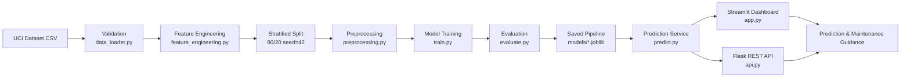

# Predictive Maintenance Intelligence System

[](https://python.org)
[](https://scikit-learn.org)
[](https://streamlit.io)
[](https://flask.palletsprojects.com)

A complete, end-to-end machine learning system for industrial machinery failure prediction using the UCI AI4I 2020 Predictive Maintenance Dataset.

> **Academic Project Notice:** This is a college mini-project and decision-support prototype. It is NOT a certified industrial safety system. All predictions are probability estimates based on a synthetic dataset and must not replace professional engineering judgement or certified maintenance protocols.

---

## Table of Contents

1. [Project Overview](#1-project-overview)
2. [Problem Statement](#2-problem-statement)
3. [Objectives](#3-objectives)
4. [Dataset](#4-dataset)
5. [System Architecture](#5-system-architecture)
6. [Folder Structure](#6-folder-structure)
7. [Installation (Windows)](#7-installation-windows)
8. [Running the Pipeline](#8-running-the-pipeline)
9. [Streamlit Dashboard](#9-streamlit-dashboard)
10. [Flask REST API](#10-flask-rest-api)
11. [Running Tests](#11-running-tests)
12. [Model Comparison Results](#12-model-comparison-results)
13. [Limitations and Ethical Considerations](#13-limitations-and-ethical-considerations)
14. [Future Scope](#14-future-scope)
15. [References](#15-references)

---

## 1. Project Overview

This system predicts whether industrial machinery is likely to fail based on six operational parameters. It features:

- **4 trained ML models** compared on multiple metrics
- **Streamlit dashboard** with 7 interactive pages
- **Flask REST API** for programmatic access
- **Batch CSV prediction** with downloadable results
- **Feature importance and SHAP explainability**
- **No target leakage** — failure-mode columns are never used as inputs

---

## 2. Problem Statement

Industrial machinery failures cause unplanned downtime, safety risks, and significant financial losses. Predictive maintenance (PdM) uses sensor data to detect anomalies and predict failures before they occur, enabling timely inspection and reducing costly unplanned shutdowns.

---

## 3. Objectives

- Predict binary machine failure (Yes/No) from operational parameters
- Estimate the probability of failure for each observation
- Compare multiple ML models using precision, recall, F1, ROC-AUC, and PR-AUC
- Provide an interactive dashboard for exploration and live prediction
- Offer a REST API for integration with other systems
- Demonstrate feature importance and explainability

---

## 4. Dataset

**Name:** UCI AI4I 2020 Predictive Maintenance Dataset  
**Source:** https://archive.ics.uci.edu/dataset/601/ai4i+2020+predictive+maintenance+dataset  
**DOI:** https://doi.org/10.24432/C5HS5C

> **IMPORTANT:** This dataset is **synthetic** — it was mathematically generated to resemble realistic industrial conditions but does NOT originate from real machine telemetry. It is intended for research and educational purposes.

**Citation:**
> Matzka, S. (2020). *AI4I 2020 Predictive Maintenance Dataset*. UCI Machine Learning Repository. https://doi.org/10.24432/C5HS5C

### Dataset Schema

| Column | Type | Description |
|--------|------|-------------|
| UDI | int | Unique identifier (dropped) |
| Product ID | str | Product serial number (dropped) |
| **Type** | str | Product quality: L, M, H |
| **Air temperature [K]** | float | Ambient air temperature in Kelvin |
| **Process temperature [K]** | float | Process temperature in Kelvin |
| **Rotational speed [rpm]** | int | Spindle rotational speed |
| **Torque [Nm]** | float | Applied torque in Newton-meters |
| **Tool wear [min]** | int | Cumulative tool wear in minutes |
| Machine failure | int | **Target**: 1=failure, 0=normal (never used as input) |
| TWF | int | Tool Wear Failure (leakage column — never input) |
| HDF | int | Heat Dissipation Failure (leakage column) |
| PWF | int | Power Failure (leakage column) |
| OSF | int | Overstrain Failure (leakage column) |
| RNF | int | Random Failure (leakage column) |

Bold = used as input features. Leakage columns are used for EDA only.

---

## 5. System Architecture



### Feature Engineering (inside Pipeline)

| Derived Feature | Formula | Rationale |
|---|---|---|
| Temperature difference [K] | Process temp - Air temp | Thermal stress indicator |
| Mechanical power [W] | Torque x RPM x 2pi/60 | Energy consumption metric |
| Wear-torque interaction | Tool wear x Torque | Combined stress measure |

---

## 6. Folder Structure

```
predictive-maintenance-system/
├── app.py                    # Streamlit dashboard (7 pages)
├── api.py                    # Flask REST API
├── conftest.py               # pytest configuration
├── requirements.txt
├── README.md
├── .gitignore
├── .env.example
├── config/
│   ├── __init__.py
│   └── config.py             # Central configuration (paths, features, params)
├── data/
│   ├── raw/                  # Place ai4i2020.csv here
│   └── processed/
├── models/                   # Saved .joblib pipelines + registry
├── reports/
│   └── figures/              # Generated evaluation plots
├── src/
│   ├── __init__.py
│   ├── data_loader.py        # Load & validate UCI dataset
│   ├── preprocessing.py      # sklearn Pipeline builder
│   ├── feature_engineering.py # Derived features (no leakage)
│   ├── train.py              # Multi-model training workflow
│   ├── evaluate.py           # Metrics + plot generation
│   ├── predict.py            # Shared prediction service
│   ├── explainability.py     # Feature importance, permutation, SHAP
│   └── utils.py              # Logging, file I/O helpers
├── tests/
│   ├── test_preprocessing.py
│   ├── test_predictions.py
│   └── test_api.py
├── scripts/
│   ├── download_data.py      # Auto-download UCI dataset
│   └── run_pipeline.py       # End-to-end training runner
└── docs/
    └── mini_project_report.md
```

---

## 7. Installation (Windows)

### Prerequisites
- Python 3.11+ ([download](https://python.org/downloads))
- pip (included with Python)

### Steps

```powershell
# 1. Navigate to the project folder
cd "C:\Users\hp\Desktop\ML-mini-project"

# 2. (Optional) Create a virtual environment
python -m venv .venv
.\.venv\Scripts\Activate.ps1

# 3. Install dependencies
pip install -r requirements.txt

# 4. Download the dataset (attempts automatic download)
python scripts/download_data.py
```

If automatic download fails, place `ai4i2020.csv` manually in `data\raw\`.

---

## 8. Running the Pipeline

```powershell
# Train all models and generate evaluation reports
python scripts/run_pipeline.py
```

This will:
1. Validate the dataset
2. Train Logistic Regression, Random Forest, SVM, and Gradient Boosting
3. Evaluate all models on the held-out test set
4. Save model artifacts to `models/`
5. Save metrics to `reports/`
6. Generate evaluation plots in `reports/figures/`

---

## 9. Streamlit Dashboard

```powershell
streamlit run app.py
```

Opens at `http://localhost:8501`

### Pages

| Page | Description |
|------|-------------|
| Executive Overview | KPIs, class distribution, key findings |
| Exploratory Data Analysis | Distributions, correlations, scatter plots |
| Predict Machine Failure | Live prediction form with probability gauge |
| Model Evaluation | Comparison table, ROC/PR curves, confusion matrices |
| Batch Prediction | CSV upload, bulk scoring, downloadable results |
| Model Explainability | Feature importance, permutation importance, SHAP |
| About the Project | Background, methodology, tech stack |

---

## 10. Flask REST API

```powershell
python api.py
```

Runs at `http://localhost:5000`

### Endpoints

| Method | Endpoint | Description |
|--------|----------|-------------|
| GET | `/health` | Service status and model availability |
| GET | `/model-info` | Active model and input schema |
| POST | `/predict` | Single-record failure prediction |
| POST | `/predict-batch` | Batch prediction (JSON array) |

### Example Requests (PowerShell)

**Health check:**
```powershell
Invoke-RestMethod -Uri "http://localhost:5000/health" -Method GET
```

**Single prediction:**
```powershell
$body = @{
    type = "M"
    air_temperature_k = 300.1
    process_temperature_k = 310.5
    rotational_speed_rpm = 1500
    torque_nm = 40.0
    tool_wear_min = 100
} | ConvertTo-Json

Invoke-RestMethod -Uri "http://localhost:5000/predict" -Method POST `
    -ContentType "application/json" -Body $body
```

**Example response:**
```json
{
  "predicted_label": 0,
  "predicted_class": "No Failure",
  "failure_probability": 0.087234,
  "failure_probability_pct": 8.72,
  "model_name": "Random Forest",
  "threshold": 0.5
}
```

**Batch prediction (curl):**
```bash
curl -X POST http://localhost:5000/predict-batch \
  -H "Content-Type: application/json" \
  -d '[{"type":"M","air_temperature_k":300,"process_temperature_k":310,"rotational_speed_rpm":1500,"torque_nm":40,"tool_wear_min":100}]'
```

---

## 11. Running Tests

```powershell
# Run all tests with verbose output
pytest tests/ -v --tb=short

# Run a specific test file
pytest tests/test_preprocessing.py -v
pytest tests/test_predictions.py -v
pytest tests/test_api.py -v
```

---

## 12. Model Comparison Results

*Results are populated after running `python scripts/run_pipeline.py`.*

See `reports/model_comparison.csv` for the full results table.
See `reports/metrics.json` for detailed per-model metrics.

| Metric | Notes |
|--------|-------|
| Accuracy | Misleading for imbalanced data (~96.6% baseline) |
| Precision | Fraction of predicted failures that are real |
| Recall | Fraction of real failures that are detected |
| F1-Score | Harmonic mean of precision and recall |
| ROC-AUC | Area under the ROC curve |
| PR-AUC | Area under the Precision-Recall curve (primary metric) |

**Best model selection:** The model with the highest PR-AUC on the held-out test set is selected as default. PR-AUC is prioritised because detecting actual failures (recall) is more important than minimising false alarms.

---

## 13. Limitations and Ethical Considerations

- The model is trained on **synthetic** data; its performance on real machinery is unknown.
- A **"No Failure"** prediction does NOT guarantee that a machine is safe.
- Deploying this system for safety-critical decisions requires validation on real-world data.
- The system should augment, not replace, qualified maintenance engineers.
- Class imbalance (~3.4% failures) makes the problem inherently challenging.
- Threshold selection involves a trade-off: lower thresholds reduce missed failures but increase false alarms.

---

## 14. Future Scope

- Real-time telemetry ingestion (MQTT, Apache Kafka)
- Time-series modelling (LSTM, Temporal Fusion Transformer)
- Automatic drift detection and model retraining
- Multi-class failure mode prediction (not just binary)
- Federated learning across multiple manufacturing sites
- CMMS integration for automated work-order generation
- Explainability dashboards for maintenance engineers

---

## 15. References

1. Matzka, S. (2020). *AI4I 2020 Predictive Maintenance Dataset*. UCI Machine Learning Repository. https://doi.org/10.24432/C5HS5C
2. Pedregosa, F., et al. (2011). Scikit-learn: Machine Learning in Python. *JMLR*, 12, 2825-2830.
3. Plotly Technologies Inc. (2015). Collaborative data science. Montreal, QC. https://plot.ly
4. Lundberg, S. M., & Lee, S. I. (2017). A unified approach to interpreting model predictions. *NeurIPS*, 30.
5. Chawla, N. V., et al. (2002). SMOTE: Synthetic Minority Over-sampling Technique. *JAIR*, 16, 321-357.
